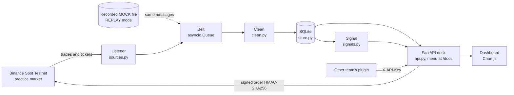

# Centralized Trading Engine

A small trading **gateway** for the Binance Spot Testnet (a practice market that uses toy money):

- **listens** to live trades;
- **cleans** each trade message into one tidy row and stores it in SQLite;
- gives **BUY / SELL / HOLD advice** from two moving averages (advice only);
- forwards **signed orders**.

It also publishes a documented API that other teams' plugins can use.

Built for CS698B (IIT Kanpur, 2026-27 Sem I). It covers the course's five components: ETL, AIML, VIZ, APP and DEV.



## Run it in three commands
```bash
pip install -r requirements.txt
python run.py                 # REPLAY: recorded MOCK data, no internet, no keys
# open http://localhost:8000  (dashboard)  and  http://localhost:8000/docs  (API menu)
```
To run LIVE on Binance Spot Testnet:
1. Copy `.env.example` to `.env`.
2. Paste in your Testnet keys.
3. Run `python run.py --live`.

## Where each course component lives
| Component | What it means here | Files |
|---|---|---|
| **ETL** | Listen to Binance, clean every message, keep it in SQLite | `engine/sources.py`, `engine/clean.py`, `engine/store.py`, `engine/pipeline.py` |
| **AIML** | Moving-average crossover advice, honestly tested against a baseline on later minutes | `engine/signals.py` |
| **VIZ** | Dashboard: price line, two averages, BUY ▲ / SELL ▼ in words, light and dark | `dashboard/` |
| **APP** | One program on one laptop: `python run.py` starts and stops every part | `run.py`, `engine/api.py` |
| **DEV** | Documented API for other teams, a mock (REPLAY) mode, client examples, a changelog | `plugin/`, `/docs` |

## Read the code in this order
1. `docs/00_START_HERE.md`: the whole idea in everyday words.
2. `engine/sources.py` → `clean.py` → `store.py` → `pipeline.py`: the data pipe.
3. `engine/signals.py`: the advice.
4. `engine/exchange.py`: signing an order.
5. `engine/api.py`: the web API.
6. `dashboard/app.js`: the screen.

Every file opens with an "In plain words" note.

## Tests
```bash
python -m pytest -q
```
No test needs the internet: they use the recorded MOCK file and a pretend exchange. The signing test checks our seal against the worked example in Binance's own documentation.

## For other teams
Start with [`plugin/INTEGRATE_IN_15_MIN.md`](plugin/INTEGRATE_IN_15_MIN.md). The contract is [`plugin/openapi.json`](plugin/openapi.json).

## Honest notes
- Testnet prices are their own practice prices, not the real Binance market.
- The signal is advice only. The engine never places an order by itself.
- Next-minute direction is close to a coin toss. The dashboard shows the rule's accuracy next to the "always guess the commonest" baseline, scored on later minutes only.
- Prices in `data/replay/` and in the snapshot are MOCK.
